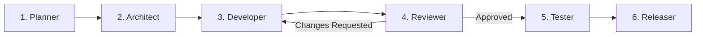

# 6-Stage Engineering Pipeline

This repository implements a modular 6-stage subagent pipeline tailored for high-performance C++20 signal processing and computer vision development.



---

## The 6 Stages

| # | Subagent | Role | Write/Run Tools | Primary Focus |
|---|----------|------|-----------------|---------------|
| 1 | **[planner.md](../.gemini/agents/planner.md)** | Planner | Read-Only | Deconstructs tasks into scoped milestones, target file paths, CPU vs. GPU requirements, and acceptance criteria. |
| 2 | **[architect.md](../.gemini/agents/architect.md)** | Architect | Write Docs | Authors or updates C++20 interface contracts and architectural specs under `docs/designs/<topic>.md`. Decouples CPU from GPU logic. |
| 3 | **[developer.md](../.gemini/agents/developer.md)** | Developer | Write & Execute | Implements C++20 code, CMake targets, and verifies local builds with `cmake --preset cpu-debug`. |
| 4 | **[reviewer.md](../.gemini/agents/reviewer.md)** | Reviewer | Read-Only / Git Audit | Audits diffs for memory safety, RAII, numeric stability, Nyquist bounds, and CPU/GPU isolation. Verdicts: `APPROVE` or `REQUEST_CHANGES`. |
| 5 | **[tester.md](../.gemini/agents/tester.md)** | Tester | Write & Execute | Implements deterministic unit tests under `tests/` and validates with ASan/UBSan: `cmake --preset cpu-asan && ctest --preset cpu-asan`. |
| 6 | **[releaser.md](../.gemini/agents/releaser.md)** | Releaser | Write & Execute | Updates `CHANGELOG.md`, checks release readiness, prepares tags/PRs, and coordinates remote GPU CI workflows. |

---

## Running the Pipeline

### Option A: End-to-End Orchestration via `run_workflow`

You can run the entire pipeline autonomously using the Antigravity workflow tool:

```python
# In an Antigravity workflow invocation:
run_workflow(
    ScriptPath="D:/subash/Github/Filtering/filteringAgent/.gemini/workflows/pipeline.py",
    Description="Execute 6-stage pipeline for a DSP feature",
    Args={"task": "Implement 1D FIR filter module with Kaiser window design"}
)
```

The workflow script:
- Dynamically loads prompt templates from `.gemini/agents/*.md`.
- Manages state handoff between phases.
- Automatically initiates developer remediation if the reviewer requests changes.
- Validates the build and ASan test suite before moving to release readiness.

### Option B: Interactive Subagent Invocations

You can also invoke any subagent individually during conversation:
- `invoke_subagent(TypeName="planner", Prompt="...")`
- `invoke_subagent(TypeName="architect", Prompt="...")`
- `invoke_subagent(TypeName="developer", Prompt="...")`
- `invoke_subagent(TypeName="reviewer", Prompt="...")`
- `invoke_subagent(TypeName="tester", Prompt="...")`
- `invoke_subagent(TypeName="releaser", Prompt="...")`
